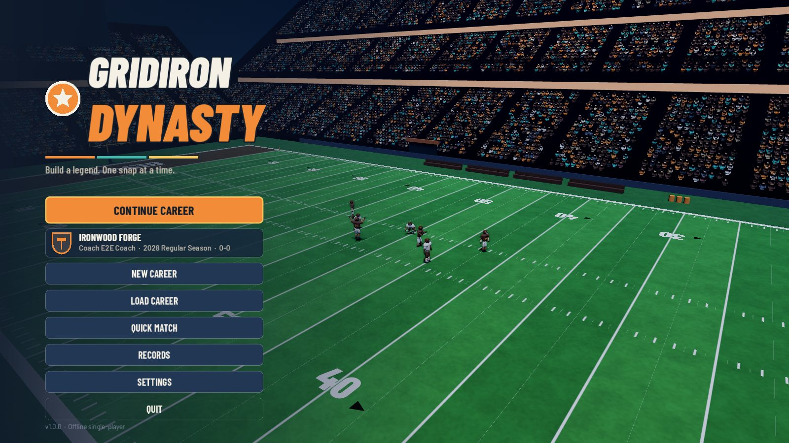
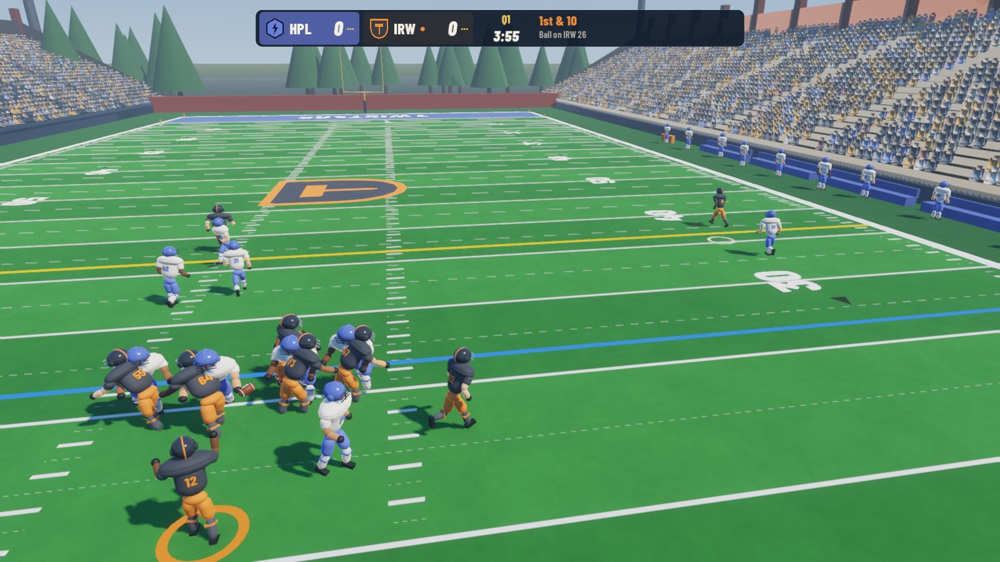
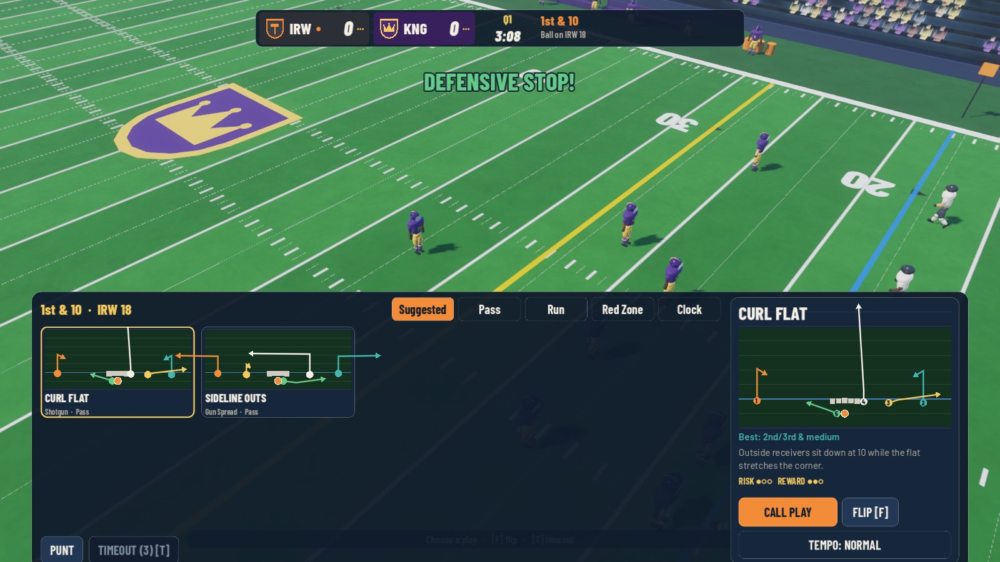
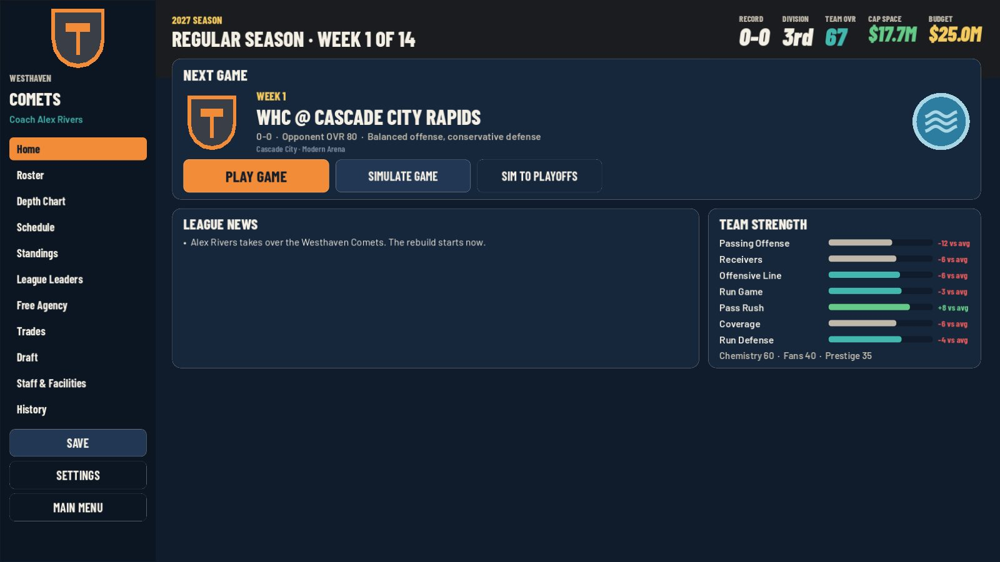

# Gridiron Dynasty

A single-player 3D arcade American football game with a deep franchise mode.
Take over an overlooked franchise, call every offensive play in real time, and
build a dynasty through scouting, drafting, development, contracts and
coaching — season after season.

Built with **Godot 4.7.2** (GDScript, Forward+ renderer with automatic
OpenGL fallback). Offline, no accounts, no ads, no network access.

---

| | |
|---|---|
|  |  |
|  |  |

## Playing

### Controls

| Action | Keyboard & mouse | Controller |
|---|---|---|
| Move | W A S D / arrows | Left stick |
| Sprint | Shift | RT / R2 |
| Snap | Space | A / Cross |
| Select receiver | 1 – 5 (numbers float over receivers) | A B X Y RB |
| Throw | Hold left mouse to charge, release to throw | Hold the receiver's button, release |
| Fine aim | Mouse (aim point / lead) | Right stick |
| Cancel target · Throw away | Q · E | LB · Back |
| Juke · Dive (ball carrier) | Space · C | A · B |
| Pre-snap: flip · audible · timeout · routes | F · R · T · Tab | Y · X · D-pad down · D-pad up |
| Replay last big play | V | D-pad left |
| Pause | Esc | Start |
| Kicking | A/D aim, Space start power, Space again to kick | Stick aim, A twice |

Menus are fully navigable with keyboard (arrows/Tab/Enter/Esc) or a controller
(D-pad/stick, A to select, B to go back). The full table is also in
**Settings → Controls**.

### How a game works
* You control the **offense**: pick a play from the diagram-based play-call
  screen, read the defense, snap, then pass or run in real time.
* Passing: pick a receiver (1–5 or point at him with the mouse), hold to
  charge, release. More power = faster, flatter throw that gets there sooner
  but is harder to catch and less accurate at full power; too little power
  falls short. Throws lead receivers along their route. Pressure, throwing on
  the run and a QB's accuracy rating all add error. "Standard" assistance
  shows where the ball will land; "Full" throws automatically with ideal lead
  and power.
* Your **defense** is simulated drive by drive (shown as a play-by-play ticker
  with the field markers moving), using the same rules engine.
* Field goals and extra points are a skill mini-game (aim, two-press power
  meter, wind). Kickoffs and punts are shown with real ball flight and returns.

### Franchise mode
Rosters with position-specific ratings, depth charts, a 10/14/15-game
schedule, standings with tiebreakers, an 8-team playoff and the Crown Bowl.
In the offseason: awards and records, retirements, contract expirations and
re-signing, a 5-round draft with scouting uncertainty, free agency, training
camp development, then the next season. Trades (with CPU offers), staff
hiring, facility upgrades, finances, morale and decision events all have
explicit effects. Careers autosave after every game and offseason step.

## Download / run the builds

Packaged release builds are committed in `dist/` (checksums in
`dist/SHA256SUMS.txt`); raw exports go to `build/` (not committed). See
**Building** below.

| Platform | File | How to run |
|---|---|---|
| Windows 10/11 (x86_64) | `dist/GridironDynasty-1.0.0-windows-x86_64.zip` | Unzip and double-click `GridironDynasty.exe` (single self-contained executable). SmartScreen may warn because the build is unsigned: *More info → Run anyway*. |
| macOS 11+ (Universal: Apple Silicon + Intel) | `dist/GridironDynasty-1.0.0-macos-universal.zip` | Unzip, then right-click **Gridiron Dynasty.app → Open** the first time. The app is ad-hoc signed only (not notarized), so Gatekeeper warns; or run `xattr -dr com.apple.quarantine "Gridiron Dynasty.app"`. |
| Linux (x86_64) | `dist/GridironDynasty-1.0.0-linux-x86_64.tar.gz` | Extract, then run `./GridironDynasty.x86_64`. |

Saves and settings live in the per-user data folder:
* Windows: `%APPDATA%\GridironDynasty\`
* macOS: `~/Library/Application Support/GridironDynasty/`
* Linux: `~/.local/share/GridironDynasty/`

(`saves/career_N.json` + `career_N.bak.json` backups, `settings.cfg`,
`records.json`.)

## Building from source

Requirements:
* Godot **4.7.2-stable** (standard build, not .NET) from godotengine.org.
* Godot 4.7.2 **export templates** (Editor → Manage Export Templates →
  Download, or install `Godot_v4.7.2-stable_export_templates.tpz`).
* No other dependencies. (Optional: Python 3 + numpy + ffmpeg only if you
  want to regenerate the audio with `tools/generate_audio.py`.)

Open the project folder in the Godot editor and press **F5** to play, or use
the command line:

```sh
godot --path .                        # run the game
godot --headless --path . --import    # import assets once (first run)

# Exports (presets are in export_presets.cfg)
godot --headless --path . --export-release "Windows Desktop" build/windows/GridironDynasty.exe
godot --headless --path . --export-release "macOS"           build/macos/GridironDynasty.zip
godot --headless --path . --export-release "Linux"           build/linux/GridironDynasty.x86_64
```

All three exports can be produced from Linux, Windows or macOS. A `.dmg`
installer, Apple code signing with a Developer ID and **notarization require a
Mac with Xcode and an Apple Developer account**: set
`codesign/codesign=3` (Xcode) with your identity and `notarization/notarization`
in the macOS preset, or sign/notarize the exported `.app` with `codesign` +
`xcrun notarytool`. Windows Authenticode signing needs a code-signing
certificate (`codesign/enable` in the Windows preset, using `signtool`).

## Testing

```sh
tools/test.sh            # unit + integration tests (headless)
tools/lint.sh            # compile-check every script
godot --path . -s res://tools/e2e.gd -- scenario=<name>   # drive the real app
godot --headless --path . -s res://tools/balance.gd -- n=200   # gameplay balance stats
```

E2E scenarios (`tools/e2e_scenarios.gd`): `smoke`, `career` (TEST A),
`match` (full autoplayed live match, TESTS B–G), `input` (real keyboard,
mouse and gamepad events, pause, fullscreen and resize — TEST K), `season`
(TEST H), `persist_a` + `persist_b` (TEST I, separate processes),
`settings_a` + `settings_b` (TEST J), `stability` (TEST L), `champ`, `screens`.
Optional arguments: `speed=<n>` (time acceleration, e.g. 4–8 for headless
match runs), `timeout=<game seconds>` (default 600 — raise it for `match`
and `stability`, e.g. `timeout=7200`), `out=<screenshot dir>`.

Exported builds accept QA switches (ignored otherwise):
`-- qa_shot=<png> qa_delay=<sec> qa_quit=1 qa_flow=quickmatch|career`.

See **docs/TEST_REPORT.md** for the latest verified results,
**docs/RULES.md** for the rule set and simplifications, and
**docs/CHECKLIST.md** for the development checklist.

## Project layout

```
data/                 teams, names, playbook, stadiums, difficulty (JSON)
scripts/autoload/     App (flow), Settings, Audio, SaveManager
scripts/football/     rules engine, game state, playbook, drive simulator, kicking model, stats
scripts/match/        live play, agents, ball, pass math, camera, kicking game, inputs, replays, match controller
scripts/world/        player rig, field, stadium builders
scripts/franchise/    league, players, teams, season, progression, contracts, draft, trades, finance, awards, ops
scripts/ui/           UI kit/theme, HUD, settings, widgets (logos, portraits, play diagrams), screens
assets/               fonts (OFL), synthesized audio, shaders, icon
tests/                headless unit/integration tests
tools/                test/lint/e2e/balance drivers, audio generator, visual harness
```

## Troubleshooting
* **Black screen or crash at start (old GPU/driver):** the game falls back to
  OpenGL automatically if Vulkan/Metal is unavailable. You can force it:
  `GridironDynasty.exe --rendering-driver opengl3`.
* **Low frame rate:** Settings → Display → Graphics Quality → Low (reduces
  crowd density, shadows and post-processing; applies from the next match).
* **Save problems:** the game keeps a backup of every slot and restores it
  automatically if the main file is damaged. Saves are plain JSON in the data
  folder above.
* **No sound:** check Settings → Audio bus volumes and your OS output device.
* **Controller not detected:** connect it before launching or reconnect;
  Settings → Controls shows the detected device.

## Credits & licenses
Original game code, design, procedural art, synthesized audio and fictional
league. Fonts: Barlow / Barlow Condensed (SIL OFL 1.1). Engine: Godot (MIT).
See THIRD_PARTY.md.
